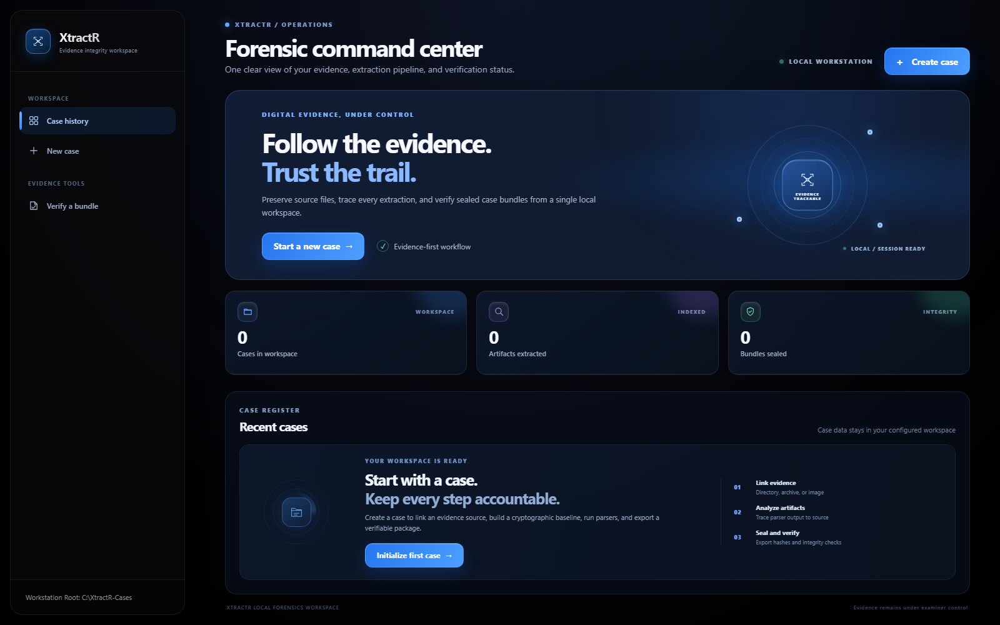
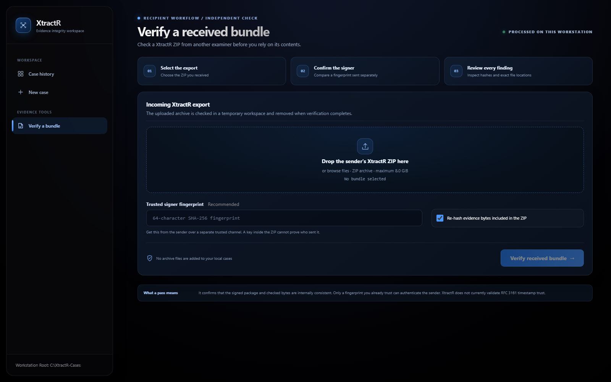

<div align="center">

# XtractR

### Local-first digital evidence extraction and verification workspace

A case-centered interface for evidence intake, analysis, chain-of-custody review, export, and integrity verification.

[Launch](#quick-start) · [Interface](#interface-preview) · [Workflow](#case-workflow) · [Verification](#verification-and-hash-inventory) · [Limitations](#security-and-operational-notes)


</div>

## Interface preview

The local interface uses a shared navy and blue visual system, a custom evidence-trace mark, motion-led page transitions, live case metrics, and a focused recipient verification workspace. Motion is brief and respects `prefers-reduced-motion`.

<p align="center">
  
  
</p>

Run the app and open **Verify a bundle** in the sidebar, or go straight to `http://127.0.0.1:5000/?view=received-verification`.

## What XtractR does

XtractR organizes a forensic workflow around a local case directory. It can establish a SHA-256 baseline for source files, run available artifact parsers, build timelines and reports, create a signed export, and inspect a case with an integrity verification phase.

### Case workflow

1. **Initialize** a case and investigator identity.
2. **Link evidence** from a supported source and record its baseline.
3. **Analyze** using installed parsers, timeline generation, and correlation.
4. **Review** artifacts, custody records, and the generated report in the GUI.
5. **Export** a signed case bundle, optionally including evidence bytes.
6. **Verify** the case and bundle, with findings reported by check and file or record location.

### Evidence hash inventory

Each export includes `evidence_manifest.json` and a human-readable `README_EVIDENCE.md` inventory with five digests for every source file:

| Algorithm | Purpose |
|---|---|
| SHA-256 | Primary integrity comparison and baseline |
| SHA-512 | Strong independent digest |
| SHA-384 | Strong independent digest |
| SHA-1 | Legacy compatibility only |
| MD5 | Legacy compatibility only |

Use SHA-256, SHA-512, and SHA-384 for integrity comparisons. SHA-1 and MD5 are present for compatibility; they should not be used alone to establish integrity.

## Quick start

Use Python 3.10 or newer. The default server binds to `127.0.0.1` and stores cases in `~/XtractR-Cases`.

```powershell
python -m venv .venv
.venv\Scripts\Activate.ps1
python -m pip install Flask cryptography
python run_gui.py
```

Open [http://127.0.0.1:5000](http://127.0.0.1:5000). To open the recipient verifier directly, use [http://127.0.0.1:5000/?view=received-verification](http://127.0.0.1:5000/?view=received-verification). To choose another local case directory or port:

```powershell
python run_gui.py --host 127.0.0.1 --port 5050 --cases-root C:\Forensics\XtractR-Cases
```

Install the full `requirements.txt` for the CLI and optional disk-image workflows. Availability of `pytsk3` and E01 support depends on the operating system and installed libraries.

## Verification and hash inventory

### Verify evidence received from another examiner

Open **Verify a bundle** in the always-visible Evidence tools section of the sidebar. Choose the sender's XtractR `.zip` export, then enter the sender's SHA-256 public-key fingerprint if you have received it through a separate trusted channel. XtractR checks the signed manifest, exported file hashes, database, custody ledger, cryptographic seal, and—when included—each evidence file against its five-digest inventory. It does not extract the archive into your case workspace; its temporary verification copy is removed when the job ends.

Without an independently trusted fingerprint, the UI reports internal integrity consistency while clearly marking the sender as unauthenticated. A public key shipped inside the archive cannot establish who sent it. If the sender omitted evidence bytes, XtractR can inspect the signed inventory but cannot compare it with a separate original source you received.

The standalone recipient verifier accepts the ZIP directly:

```powershell
$trustedFingerprint = Read-Host "Trusted SHA-256 signer fingerprint"
python xtractr_verify.py verify-bundle "C:\Evidence\received-case.zip" --expect-fingerprint $trustedFingerprint
```

For an integrity-only review when no trusted fingerprint is available, pass `--allow-unpinned`; the verifier will still identify the result as unauthenticated. Use `--skip-evidence` only when you intentionally want to skip re-hashing evidence bytes in the ZIP. The GUI upload limit defaults to 8 GiB and can be changed with `XTRACTR_MAX_VERIFY_UPLOAD_BYTES`.

### Verify one of your local cases

The case-specific **Verification** screen checks the local database, seal, manifest, bundle, custody records, signer pin, timestamp-token status, and optionally the original linked evidence source. Failed checks include the affected path or record and, where available, expected and observed values.

The five evidence digests are SHA-256, SHA-512, SHA-384, SHA-1, and MD5. Use the first three for integrity comparisons; SHA-1 and MD5 are included for legacy compatibility only.

## Security and operational notes

- By default, the GUI is intended for use on the local workstation. Do not bind it to a public or untrusted network without adding authentication, TLS, and deployment hardening.
- The investigator's private signing key is encrypted with the passphrase. Case databases and evidence files are **not encrypted at rest** by XtractR; use an encrypted volume and appropriate access controls.
- Process isolation for parsers is not an operating-system sandbox. Treat evidence and third-party plugins as untrusted input.
- RFC 3161 timestamp requests are present, but response validation is incomplete. A TSA token's presence is not proof of a trusted timestamp.
- XtractR is an engineering tool. Validate its behavior and procedures against your organization's forensic standards before relying on results in a case.

See [THREAT_MODEL.md](THREAT_MODEL.md), [docs/forensic_integrity.md](docs/forensic_integrity.md), [docs/ARCHITECTURE.md](docs/ARCHITECTURE.md), and [docs/UI_PRODUCT_AUDIT.md](docs/UI_PRODUCT_AUDIT.md) for implementation detail and product rules.

## Repository map

```text
core/                  Case storage, cryptography, evidence, analysis, and export
plugins/               Artifact parsers
gui/                    Flask application and web interface
xtractr_verify.py       Standalone post-export verifier
main.py                 Command-line workflow
```

## License

See [LICENSE](LICENSE).
